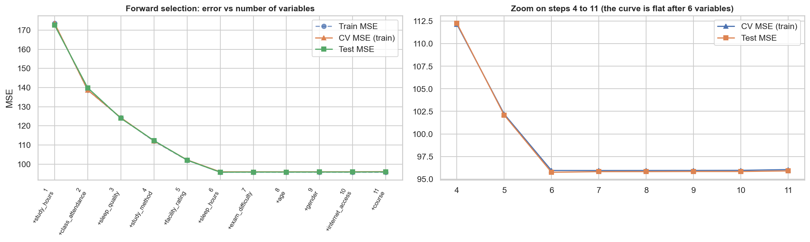
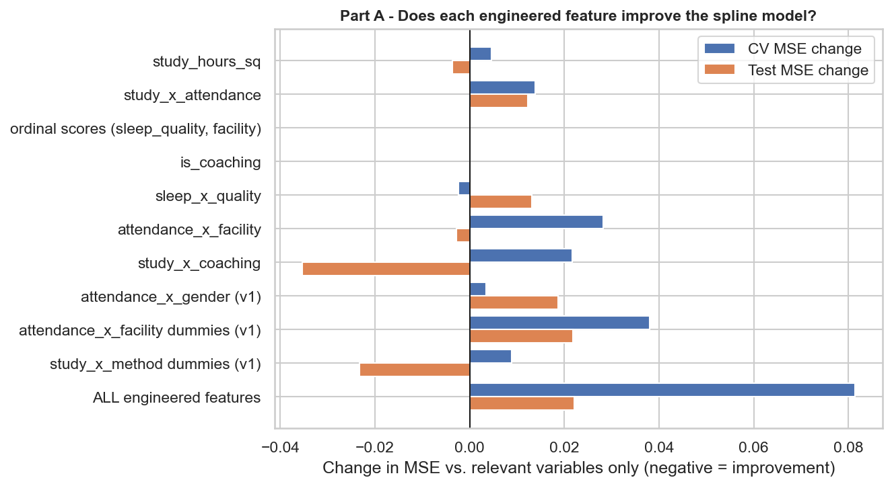
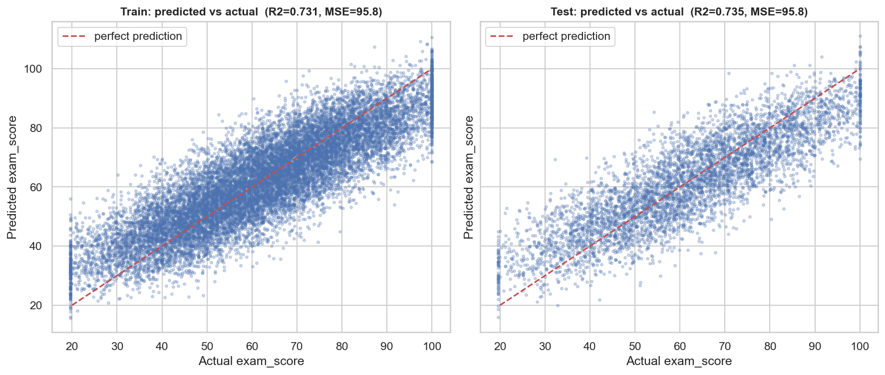
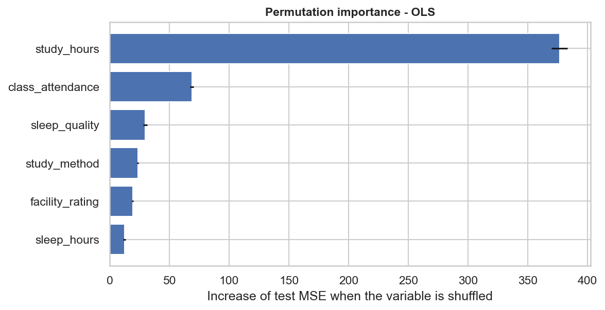
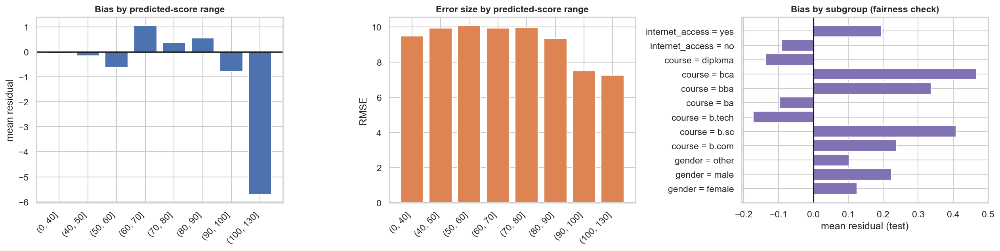
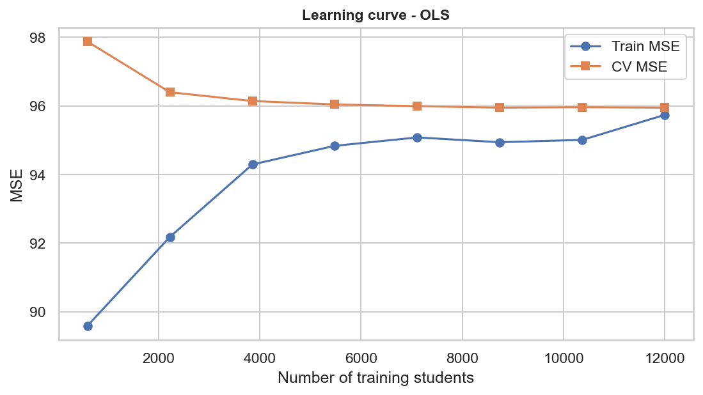

# Predicting Student Exam Scores

**Aix-Marseille University - Machine Learning - Project 1**

Group name: _<your group name>_  
Authors: _<NAME1, NAME2, NAME3>_

---

## 1. Project overview

The goal is to predict the **exam score (0-100)** of a student from study habits, personal characteristics and educational context. This is a **regression** problem on 20,000 students and 11 explanatory variables.

The project compares four families of regression models (OLS, polynomial, spline, random forest), then builds and selects variables, tunes hyper-parameters, evaluates the best model, and discusses the ethical aspects of such a model.

**Main findings**

- The score is, to a very good approximation, a **linear and additive** function of **6 variables**. Five variables (age, gender, course, internet access, exam difficulty) carry no information.
- The best model is a plain **linear regression on these 6 variables**: **R² test = 0.735, MSE test = 95.75** (RMSE of about 9.8 points).
- More flexible models (degree-3 polynomial, random forest) do **worse**, and none of the 14 engineered features improves the model.
- About 27% of the variance remains unexplained and looks like pure noise: only new variables (e.g. previous grades) could improve the predictions.

---

## 2. Repository content

```
.
├── README.md
├── student_score_project.py     # full, commented script (run this one)
├── data_exam_score.xlsx         # dataset (title row + 20,000 students)
├── figures/                     # all figures produced by the script
├── results_1_1_all_models.csv   # Section 1.1: every model and configuration
├── results_1_2_2_spline_grid.csv
├── results_1_2_2_rf_grid.csv
└── results_final_models.csv     # tuned models on the final variables
```

## 3. How to run

```bash
pip install pandas numpy scikit-learn matplotlib seaborn scipy openpyxl
python student_score_project.py
```

- The path of the data file is set by `DATA_PATH` at the top of the script (default: `data_exam_score.xlsx` in the current folder).
- Figures are saved in `./figures`, tables in the current folder.
- The run takes about 5-10 minutes (mainly the degree-3 polynomial and the random-forest grid).

**Protocol used everywhere:** one single train/test split (75% / 25%, `random_state=42`). Every choice (hyper-parameters, variables) is made by **5-fold cross-validation on the train set only**; the test set is only used to report performance.

---

## 4. Data and exploratory analysis

| Variable | Type | Comment |
|---|---|---|
| `age`, `study_hours`, `class_attendance`, `sleep_hours` | numeric | close to uniform distributions |
| `gender`, `course`, `internet_access`, `sleep_quality`, `study_method`, `facility_rating`, `exam_difficulty` | categorical | almost perfectly balanced (except `exam_difficulty` and `internet_access`) |
| `exam_score` | target (0-100) | mean 62.5, std 18.9, almost symmetric |

**Data quality.** No missing values, no duplicated rows. The target is **censored on both sides**: 200 students (1.0%) are exactly at the floor of 19.6 and 493 (2.5%) exactly at the ceiling of 100.


**What drives the score** (share of the variance of `exam_score` explained by each variable alone):

| Variable | % of variance |
|---|---|
| `study_hours` | 51.5 |
| `class_attendance` | 9.5 |
| `sleep_quality` | 4.0 |
| `study_method` | 3.5 |
| `facility_rating` | 2.7 |
| `sleep_hours` | 1.8 |
| `course`, `internet_access`, `age`, `exam_difficulty`, `gender` | ≈ 0 (not significant, p between 0.27 and 0.83) |


Key observations:

- `study_hours`: almost perfect straight line, about **+5.9 points per extra hour**.
- `class_attendance`: +0.34 point per attendance point; `sleep_hours`: +1.4 point per hour.
- Mean score by group: coaching 68.6 vs self-study 58.7; good sleep 67.1 vs poor sleep 57.9; high facilities 66.2 vs low facilities 58.6.
- Gender, course, internet access and exam difficulty: group means differ by **less than 1 point**.
- The four numeric variables are **not correlated** with each other (|r| < 0.02): no multicollinearity, and the contributions of the variables simply add up (73% in total, which is the R² reached by the models).
- **No interaction**: the slopes are the same in every group (e.g. the `study_hours` slope is 5.8-5.9 for every study method).


---

## 5. Section 1.1 - Comparison of the algorithms (all 11 variables)

| Model | R² test | MSE test | Training time | Main hyper-parameters |
|---|---|---|---|---|
| OLS | 0.734 | 95.90 | 0.04 s | none |
| Polynomial | 0.734 | 95.90 | 0.04 s | degree = 1 (same as OLS) |
| Polynomial | 0.731 | 97.04 | 0.31 s | degree = 2 |
| Polynomial | 0.705 | 106.42 | 13.1 s | degree = 3 (1,140 generated columns) |
| Spline (best by CV) | 0.734 | 95.90 | 0.04 s | degree = 1, n_knots = 2 (a straight line) |
| Random forest | 0.689 | 112.29 | 6.3 s | n_estimators = 100, max_features = 1.0, min_samples_leaf = 1 |

All 15 spline configurations (degree 1-3, 2-6 knots) lie between 95.71 and 95.90 in test MSE.

**Comments**

- OLS is the best or tied for best. The best spline selected by cross-validation is degree 1 with 2 knots, i.e. the same model as OLS.
- Making the polynomial more flexible makes the test error **worse** (95.9 → 97.0 → 106.4): there is no curvature to capture, so the extra columns only fit noise.
- The random forest is the worst model and about 150 times slower than OLS: it approximates a straight line with steps and wastes splits on the five useless variables.


---

## 6. Section 1.2.1 - Feature engineering and variable selection

The model of choice is the **spline regression** (hyper-parameters selected in Section 1.1), with OLS as a reference.

### Part B - Variable selection

| Variable set | Number of variables | Test MSE | CV MSE |
|---|---|---|---|
| All original variables | 11 | 95.90 | 96.05 |
| Drop age | 10 | 95.90 | 96.04 |
| Drop age, gender | 9 | 95.88 | 96.04 |
| Drop age, gender, course | 8 | 95.82 | 95.96 |
| Drop age, gender, course, exam_difficulty | 7 | 95.75 | 95.96 |
| **Significant variables only (6)** | **6** | **95.75** | **95.95** |
| Quantitative habits only | 3 | 132.75 | 132.52 |
| `study_hours` only | 1 | 172.62 | 173.60 |

Cost of removing one of the 6 relevant variables (increase of test MSE): `study_hours` +191.7, `class_attendance` +32.9, `sleep_quality` +15.4, `study_method` +11.8, `facility_rating` +10.2, `sleep_hours` +6.3.

**Forward selection** (test MSE): 172.6 → 139.9 → 123.9 → 112.3 → 102.1 → **95.75** with the first six variables, then the curve is **flat**. Adding `exam_difficulty`, `age`, `gender`, `internet_access` and `course` makes the test MSE rise from 95.75 to 95.90 while the train MSE barely moves (95.76 → 95.71): the beginning of overfitting. The elbow is clearly at **6 variables**.



### Part A - Feature engineering

14 new columns in 10 families were created and tested on top of the 6 relevant variables:

| Feature (family) | Idea |
|---|---|
| `study_hours_sq` | curvature of the study effect |
| `study_x_attendance` | "effective" study time |
| `sleep_quality_score`, `facility_score` | ordinal encoding (0-1-2) |
| `is_coaching` | best study method vs all others |
| `sleep_x_quality` | hours slept x how well |
| `attendance_x_facility` | attendance effect depends on facilities |
| `study_x_coaching` | study effect depends on the method |
| attendance x gender, attendance x facility dummies, study x method dummies | interactions from the first version of the project |

**Result: none of them improves the model.** The test MSE changes between -0.035 and +0.022 (best: `study_x_coaching`, 95.715 vs 95.750), the CV MSE is unchanged or slightly worse, and all 14 features together give a CV MSE of 96.03 (worse than the 6 original variables). This is consistent with the EDA (parallel slopes, no curvature). The ordinal scores and `is_coaching` are linear combinations of the dummy variables, so they give exactly the same MSE, but they help interpretation: the effects of sleep quality (-4.7 / 0 / +4.6) and facilities (-7.8 / -3.9 / 0) are almost linear in the level.

**Decision** (parsimony rule: simplest set within 0.1 of the best CV MSE): the final model uses the **6 relevant original variables** and no engineered feature. When the data-generating process is linear and additive, adding features can only add noise.



---

## 7. Section 1.2.2 - Hyper-parameter selection

### Model 1 - Spline regression (degree 1-4, number of knots 2-15)

- The CV MSE is minimal (95.95) for **degree = 1, n_knots = 2**, i.e. a straight line.
- More knots or higher degrees lower the train MSE (95.76 → 95.4) and give nearly identical test MSE (95.56-95.75 for the best ones) but a higher CV MSE: differences of about 0.2 MSE points, which is noise.
- Very flexible splines (15 knots) lose a little accuracy (test MSE 96.0-96.1): the start of overfitting. Over the whole grid the test MSE only moves between 95.56 and 96.13.


### Model 2 - Random forest (`max_features`, `min_samples_leaf`, `n_estimators`)

- Best by CV: **max_features = 4, min_samples_leaf = 5** → CV MSE 107.5, test MSE **105.9** (R² 0.707), against 112.3 with the default values.
- `min_samples_leaf` is the key parameter: with fully grown trees (leaf = 1) the train MSE is 15 and the test MSE 109-114 (the forest memorises the noise); leaves of 5-10 regularise; leaf = 50 underfits.
- `max_features` = 4 is best; 2 is too restrictive and 8-11 make the trees too similar.
- More trees help with diminishing returns: test MSE 110.6 (10 trees), 105.9 (100), 105.1 (300), while training time grows linearly (0.13 s → 3.8 s).
- Even tuned, the forest stays about **10 MSE points worse** than the linear model: the problem is the model class (steps vs a straight line), not the tuning.


---

## 8. Section 1.3 - Best model

**Best model: linear regression (OLS) on 6 variables** - `study_hours`, `class_attendance`, `sleep_hours`, `sleep_quality`, `study_method`, `facility_rating`. The tuned spline is exactly the same model.

| Model (final variables) | R² train | R² test | MSE test | CV MSE | Hyper-parameters |
|---|---|---|---|---|---|
| **OLS** | 0.7313 | **0.7347** | **95.75** | **95.95** | none |
| Spline (tuned) | 0.7313 | 0.7347 | 95.75 | 95.95 | degree = 1, n_knots = 2 |
| Polynomial (d = 2) | 0.7322 | 0.7345 | 95.81 | 96.47 | degree = 2 |
| Random forest (tuned) | 0.8142 | 0.7067 | 105.86 | 107.47 (3-fold) | max_features = 4, min_samples_leaf = 5, n_estimators = 100 |

**Why this model?**

- **Algorithm:** lowest CV and test MSE; the EDA showed an additive linear relationship, which is exactly the OLS hypothesis. It is also fast (0.02 s) and interpretable.
- **Hyper-parameters:** none for OLS; those of the spline collapse to the linear case.
- **Variables:** the 6 variables with a significant effect; the other 5 only add noise.

**Performance:** R² train = 0.7313, **R² test = 0.7347** (no overfitting), RMSE = 9.79 points, MAE = 7.87 points. For comparison, the random forest has R² train = 0.814 but R² test = 0.707, a 0.107 overfitting gap.



**Interpretation**

| Effect | Coefficient |
|---|---|
| +1 hour of study | +5.9 points |
| +1 attendance point | +0.34 point |
| +1 hour of sleep | +1.45 point |
| good vs poor sleep quality | +9.3 points |
| coaching vs self-study | +9.5 points |
| high vs low facilities | +7.8 points |

Permutation importance (increase of test MSE when the variable is shuffled): `study_hours` 376, `class_attendance` 69, `sleep_quality` 30, `study_method` 24, `facility_rating` 19, `sleep_hours` 12.5. Study time alone dominates the prediction.



### Weaknesses of the model

1. **Large irreducible error.** 27% of the variance is not explained. The residuals are symmetric, nearly normal and have the same spread (RMSE 9.4-10.1 for predicted scores below 90) in every range of predicted score: they look like pure noise (motivation, prior level, luck...). The learning curve is already flat: more data or a more complex model will not help; only new variables could.
2. **Censored target.** Scores are cut at 19.6 and 100, but a linear model does not know it: 18 test students get a prediction above 100, the 53 students at the floor are predicted around 31 on average and the 107 students at the ceiling around 91. Clipping the predictions to [19.6, 100] lowers the test MSE from 95.75 to 95.64. A censored (Tobit) regression would be the principled solution.
3. **Wide individual uncertainty.** The 95% prediction interval is about ±19 points: a student predicted at 62 could score anywhere between 43 and 81. The model is good for describing groups and trends, not for judging one person.
4. **Fairness check.** The mean residual lies between -0.17 and +0.47 point and the RMSE between 9.5 and 10.2 for all genders, courses, internet-access and study-method groups: no visible systematic bias. The model does not use gender, age or course.
5. **Association is not causation.** The model describes correlations in this sample. The very regular data (uniform variables, perfect balance, linear additive signal) suggest a simulated dataset: on real data the performance would probably be lower and non-linearities more likely.




---

## 9. Section 1.4 - Ethical considerations

**Should universities use such a model to recruit students? No, not as a decision tool.**
The model relies on variables measured *after* enrolment (attendance, study hours, study method, facility rating), so it cannot be applied to applicants as such. Individual predictions are imprecise (±19 points). An admission model would be tempted to use proxies (internet access, school, area) that encode social disadvantage and reproduce inequalities, and could create a self-fulfilling prophecy. In the EU, GDPR (article 22) restricts decisions based solely on automated processing and the AI Act classifies AI systems used for access to education as high-risk. At most, such a model could support a human decision, with published criteria, an appeal procedure and regular fairness audits.

**Should students know their predicted scores? Yes, under conditions.**
Transparency, early warning and the ability to act are real advantages. The risks are anxiety, discouragement, self-fulfilling prophecy and false precision. Recommended practice: voluntary access, a *range* rather than a single number, an explanation of the factors and of what the student can change, support attached to the prediction, and no sharing with third parties.

**Should universities use such a model to identify key variables and plan interventions? Yes, with precautions.**
This is the most defensible use: the model points to levers on which the university can act (study time, attendance, sleep quality, coaching, facilities). Precautions: (1) the model shows association, not causation, so interventions must be piloted and evaluated (randomised or A/B tests); (2) a low facility rating is a resource problem of the institution, not a student's fault; (3) collecting sleep or study-time data is intrusive: use consent and data minimisation (the five useless variables do not need to be collected) and keep the purpose limited to support, never to sanction.

---

## 10. Limits and possible extensions

- Add variables that are really missing (previous grades, prior level) to reduce the unexplained 27%.
- Use a censored (Tobit) regression for the floor and ceiling of the score.
- Provide prediction intervals instead of single predictions.
- Check the conclusions on real, messier data.
